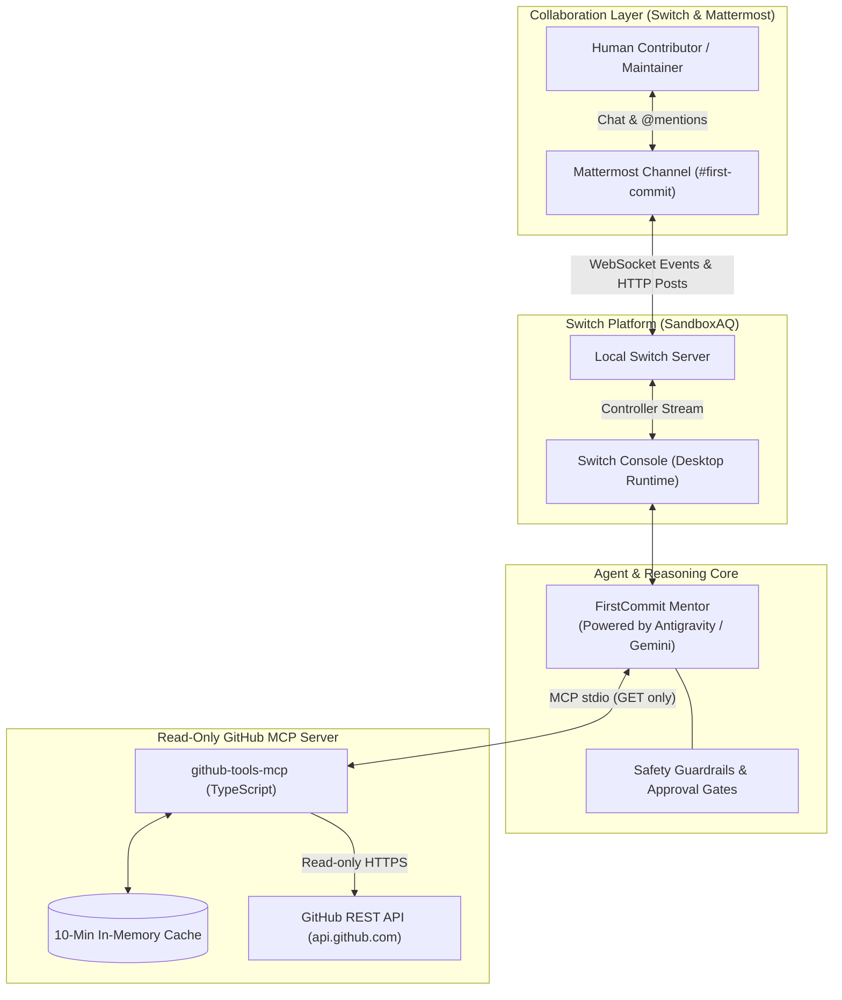

# FirstCommit 🚀
> **Empathetic Open-Source Contributor Onboarding inside Team Chat, Powered by Switch & Google Gemini.**

[](https://www.wemakedevs.org/hackathons/switch)
[](https://opensource.org/licenses/MIT)
[](https://www.typescriptlang.org/)
[](#safety--defense-in-depth)

---

## 🏆 For Hackathon Judges: The 4 Core Questions

### 1. Is Switch Central to FirstCommit? (30%)
**Yes, completely.** FirstCommit is designed natively around Switch. Switch is not a cosmetic add-on; it is the sole operational bridge and lifecycle manager:
- Switch Console manages the AI agent runtime on the host machine.
- Switch connects the agent directly into the bundled Mattermost collaboration room (`#first-commit`).
- Without Switch, the real-time event streaming, room shared context, and human-in-the-loop chat interactions would not exist.

### 2. Technical Execution & Reproducibility (25%)
- Built with a clean, decoupled architecture:
  - **Runtime & Bridge:** Switch Console + Local Switch Server + Bundled Mattermost (Docker).
  - **Reasoning Provider:** Google Antigravity / Gemini CLI (`agy`).
  - **Read-Only Data Layer:** Custom TypeScript MCP Server (`firstcommit-github-tools`) with in-memory caching and strict prompt-injection data isolation.
- Fully reproducible in **under 10 minutes** from a fresh clone with automated unit tests (`npm test`), live smoke tests (`npm run test:smoke`), and safety proof suites (`npm run test:safety`).

### 3. Creativity & Impact (25%)
- **The Problem:** The "first contribution cliff." Over 70% of aspiring open-source developers abandon their first contribution due to daunting codebases, cryptic build instructions, and fear of negative feedback. Concurrently, maintainers suffer from burnout triaging duplicate, low-quality PRs.
- **The Solution:** A 24/7 patient, encouraging peer mentor inside team chat who guides newcomers step by step, reviews diffs before submission, and prevents maintainer fatigue.

### 4. Presentation & Clarity (20%)
- Clear 3–5 minute demo workflow, comprehensive documentation, architectural sequence diagrams, and an accompanying hackathon blog post draft.

---

## 🏛️ System Architecture



---

## 🛡️ Safety & Defense-in-Depth

FirstCommit enforces safety at the architectural and code level, not just through prompt reminders:

1. **Zero Untrusted Code Execution:** The agent never clones repositories to disk, never runs shell scripts, and never executes untrusted test runners.
2. **Zero GitHub Writes (MVP):** The MCP server exposes **no write tools** (no branch creation, no commits, no automated PR submission). All changes are made by the contributor on their local machine.
3. **Prompt Injection Boundary Tags:** All external repository data (README, issues, comments, diffs) is sanitized and wrapped in strict `<untrusted_repo_data>` boundaries.
4. **Leak-Proof Secrets:** All environment settings are managed via `.env` (gitignored). `.env.example` contains only placeholders.
5. **Rate-Limit & Truncation Guards:** Automatic 10-minute cache to prevent hitting GitHub API limits; responses capped at 30,000 characters.

---

## ⚡ 10-Minute Quickstart

### Prerequisites
- Node.js 20+ installed
- Docker Desktop running (for Switch bundled Mattermost)
- Switch Console installed

### Step 1: Clone & Install Dependencies
```bash
git clone https://github.com/saicharanpatnala/FirstCommit.git
cd FirstCommit/mcp-server
npm install
```

### Step 2: Run Automated Tests
```bash
# 1. Run Unit Tests (10 tests with mocked responses)
npm test

# 2. Run Live Smoke Test (fetches real public repo: sandbox-quantum/switch)
npm run test:smoke

# 3. Run Safety Proof Tests (injection fixture, zero-write, secrets scan)
npm run test:safety
```

### Step 3: Launch Switch & Mattermost
1. Open **Switch Console**.
2. Verify **Antigravity** is signed in under `Settings -> Agent Providers`.
3. Open Mattermost at `http://localhost:60922` and enter the `#first-commit` channel.
4. Type:
   ```text
   @firstcommit-mentor Hello! I want to contribute to https://github.com/sandbox-quantum/switch. I know basic TypeScript.
   ```

---

## 🎬 3–5 Minute Demo Script

| Timestamp | Speaker / Action | Screen / Visual |
| :--- | :--- | :--- |
| **0:00 - 0:45** | **The Hook:** Problem framing — the intimidation of making a first open-source PR vs. maintainer burnout. | Slide / Problem introduction. |
| **0:45 - 1:30** | **The Switch Setup:** Showing Switch Console running locally, bundled Mattermost in Docker, and the `firstcommit-mentor` agent template. | Switch Console dashboard & Mattermost channel. |
| **1:30 - 2:30** | **Live Mentorship & Issue Discovery:** Contributor posts repo link -> Agent explains project in plain English -> Agent queries GitHub API live and recommends beginner issues. | Live Mattermost chat interaction. |
| **2:30 - 3:30** | **Approval Gate 1 & Local Guidance:** Contributor picks an issue -> Agent proposes Action Plan -> Contributor types `@firstcommit-mentor approve plan` -> Agent provides reproduction steps. | Live chat showing explicit human approval. |
| **3:30 - 4:15** | **Pre-PR Diff Review & Gate 2:** Contributor pastes diff -> Agent reviews text against guidelines -> Generates complete PR markdown description for manual submission. | Final PR review output in chat. |
| **4:15 - 5:00** | **Wrap Up:** Summary of impact, safety proofs, and how Switch enables real human-agent collaboration. | Architecture diagram & closing. |

---

## 📁 Repository Structure

```text
FirstCommit/
├── PROJECT_PLAN.md              # Living architectural plan
├── README.md                    # Project documentation & presentation (this file)
├── BLOG_POST.md                 # Hackathon Best Blog submission
├── .env.example                 # Configuration template
├── .gitignore                   # Secrets and build ignore rules
├── templates/
│   ├── firstcommit-agent.yaml   # Switch agent definition template
│   └── firstcommit-room.yaml    # Switch room definition template
└── mcp-server/                  # Read-only GitHub MCP Tool Server
    ├── package.json
    ├── tsconfig.json
    ├── src/
    │   ├── index.ts             # MCP stdio server entry point
    │   ├── github.ts            # Read-only GitHub client with cache & safety
    │   └── types.ts             # Data models
    └── tests/
        ├── github.test.ts       # Unit tests with mocks
        ├── smoke.test.ts        # Live GitHub API smoke test
        └── safety.test.ts       # Safety & injection proof tests
```

---

## 📄 License
This project is open-source under the [MIT License](LICENSE).
