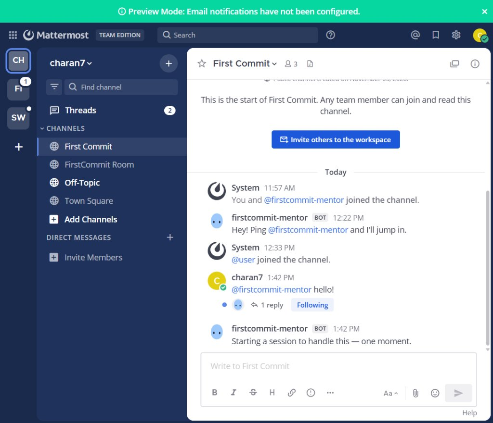
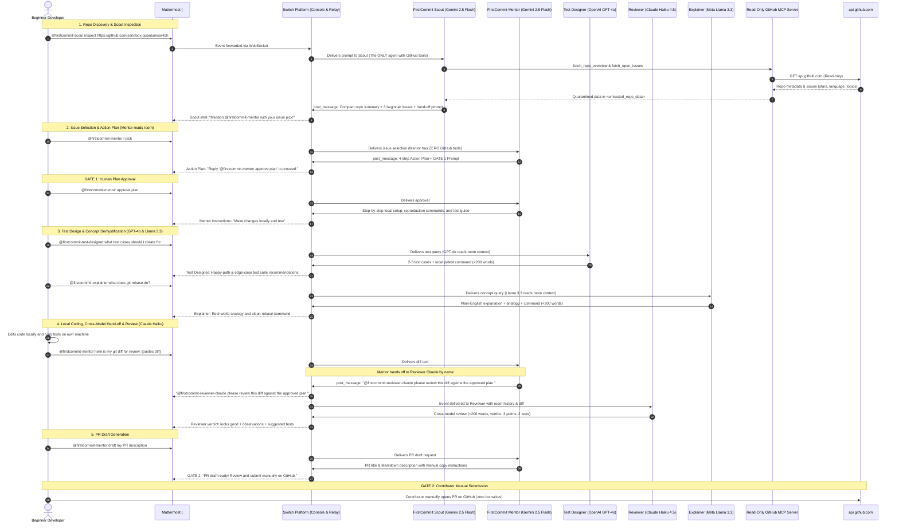

# FirstCommit 🚀
> **Empathetic Open-Source Contributor Onboarding inside Team Chat, Powered by Switch & Google Gemini.**

[](https://www.wemakedevs.org/hackathons/switch)
[](https://opensource.org/licenses/MIT)
[](https://www.typescriptlang.org/)
[](#5-safety-model-and-limitations)
[](https://switch.chat)

---

## 1. What FirstCommit Is

**FirstCommit** solves the "first contribution cliff": over 70% of aspiring open-source contributors abandon their first pull request due to daunting codebases, cryptic setup steps, and fear of negative feedback, while maintainers suffer burnout triaging low-quality PRs. FirstCommit pairs beginners with an encouraging, step-by-step AI onboarding mentor right inside their team chat (Mattermost via Switch). The mentor queries live GitHub data, recommends tailored beginner issues, formulates actionable plans through explicit human approval gates, reviews code diffs, and drafts clean PR descriptions.

- **Demo Video (3–5 min):** [Watch FirstCommit Demo Video on YouTube / Loom](https://youtu.be/placeholder-demo-video) *(Replace with recorded video link)*
- **FirstCommit Room in Action:**



---

## 2. Why Switch Is Central

Switch is the foundational communication, event orchestration, and agent lifecycle engine of FirstCommit. Without Switch, FirstCommit ceases to function:
1. **Zero Custom Bridges:** Switch natively manages the bidirectional bridge between Mattermost (WebSocket events inbound, HTTP posts outbound) and the local agent runtime. Without Switch, the agent cannot receive chat events or post back into channels and threads.
2. **Agent Supervision & Lifecycle:** Switch Console runs, health-checks, and manages the Antigravity agent process on the host machine.
3. **Room Context & Placements:** Switch orchestrates room participants, roles, shared context, and message threads, enabling genuine human-agent pair programming.

### Message-Flow Architecture



---

## 3. How Switch Is Used

### a. Agents Connected & Multi-Provider Architecture

FirstCommit demonstrates that **Switch is a truly agent-agnostic collaboration fabric**: five specialist agents across **four distinct frontier model families** (Google Gemini, OpenAI GPT, Anthropic Claude, and Meta Llama) collaborate in a single shared Mattermost room.

| Participant | Model & Provider | Working Folder | Addressing | Role & Boundaries | Template File |
| :--- | :--- | :--- | :--- | :--- | :--- |
| `firstcommit-scout` | **Google Gemini** (Gemini 2.5 Flash via Antigravity ACP) | `./FirstCommit-Scout` | `anyone` (`@firstcommit-scout`) | Repository inspection and beginner issue discovery. **The ONLY agent equipped with GitHub tools.** | [templates/firstcommit-scout.yaml](templates/firstcommit-scout.yaml) |
| `firstcommit-mentor` | **Google Gemini** (Gemini 2.5 Flash via Antigravity ACP) | `./FirstCommit-Agent` | `anyone` (`@firstcommit-mentor`) | Contributor guidance, 4-step Action Plan formulation, local testing advice, reviewer hand-off, and PR description generation. *(Zero direct tools; reads room context).* | [templates/firstcommit-agent.yaml](templates/firstcommit-agent.yaml) |
| `firstcommit-test-designer` | **OpenAI** (GPT-4o-mini via OpenRouter) | `./FirstCommit-TestDesigner` | `anyone` (`@firstcommit-test-designer`) | Designs 2–3 concrete test cases and local run commands (`pytest ...`) as static text under ~200 words. *(Zero direct tools).* | [templates/firstcommit-test-designer.yaml](templates/firstcommit-test-designer.yaml) |
| `firstcommit-reviewer-claude` | **Anthropic** (Claude Haiku 4.5 via OpenRouter) | `./FirstCommit-Reviewer` | `anyone` (`@firstcommit-reviewer-claude`) | Cross-model code diff review, scope & drift checking against approved plan, edge case flagging, and suggested tests (<200 words). *(Zero direct tools; text-only).* | [templates/firstcommit-reviewer-claude.yaml](templates/firstcommit-reviewer-claude.yaml) |
| `firstcommit-explainer` | **Meta Llama** (Llama 3.3 70B via OpenRouter) | `./FirstCommit-Explainer` | `anyone` (`@firstcommit-explainer`) | Demystifies git, GitHub, CI/CD, and open source concepts (`rebase`, `squash`, `DCO`, `CLA`) in plain English under ~200 words. *(Zero direct tools).* | [templates/firstcommit-explainer.yaml](templates/firstcommit-explainer.yaml) |

> **Unified 5-Agent Template:** The entire multi-provider team and room can be deployed together via the Version 2 unified Switch template at [templates/firstcommit-team.yaml](templates/firstcommit-team.yaml).

#### Why Several Providers in One Room
1. **Agent-Agnostic Collaboration:** Proves Switch's core value—agents from completely different AI platforms (Google, OpenAI, Anthropic, Meta) interact seamlessly in one room without custom glue code.
2. **Cross-Model Verification:** Anthropic Claude reviews code diffs developed under Google Gemini's guidance, providing an objective, independent second opinion that eliminates single-model blind spots.
3. **Task-Optimized Specialization:**
   - **Gemini 2.5 Flash:** High-speed repository data indexing, issue synthesis, and action planning.
   - **OpenAI GPT-4o-mini:** Structured edge-case identification and test scenario generation.
   - **Anthropic Claude Haiku 4.5:** Rigorous diff inspection, drift detection, and style verification.
   - **Meta Llama 3.3 70B:** Empathetic, plain-English conceptual explanations and real-world analogies.

#### Providers and Data Flow (Privacy & Least Privilege)
- **What Providers See:** Only public repository text, issue titles/descriptions, and user-pasted diffs are sent to provider APIs.
- **What Providers Never See:** ZERO credentials, personal access tokens, local file paths, or private host files are ever transmitted.
- **Untrusted Data Boundary:** All repository text and code are quarantined in `<untrusted_repo_data>` XML boundaries before evaluation, neutralizing prompt injections.
- **Least-Privilege Invariant:** Only `firstcommit-scout` has tools. The remaining 4 specialist agents have zero execution capabilities, reading exclusively from Switch's shared room history.
- **Deterministic Anti-Loop Invariants:** Agents only speak when addressed by name, make at most one hand-off per human message, and never reply to peer acknowledgements.

### b. Channel & Room Setup

- **Room Name:** `FirstCommit Onboarding Room` (auto-bridged to channel `#first-commit`)
- **Chat Application:** Mattermost (bundled inside the local Switch Docker stack: `switchdash-local-mattermost-mattermost-1` on port `60922`)
- **Bridge:** Native Switch Mattermost Collaboration Bridge
- **Participants & Roles:**
  - `charan7` (Workspace Owner / Contributor)
  - `firstcommit-scout` (AI Agent / Repository Intelligence Scout)
  - `firstcommit-mentor` (AI Agent / Onboarding Mentor & Action Planner)
  - `firstcommit-test-designer` (AI Agent / Test Design Specialist)
  - `firstcommit-reviewer-claude` (AI Agent / Independent Code Reviewer)
  - `firstcommit-explainer` (AI Agent / Plain-English Concept Guide)
- **Kickoff Message:** `"👋 Welcome to FirstCommit! We are your 5-agent open-source onboarding team across multiple model providers. Mention @firstcommit-scout with a public repo URL to get started!"`
- **Native Switch Room Features Used:**
  - **Shared Context & Room Instructions:** Injected into agent sessions to govern mentor personality, teaching style, reviewer brevity, and safety boundaries.
  - **Roles:** Dedicated roles assigned per agent (`Repository Scout`, `Contribution Mentor`, `Test Designer`, `Code Reviewer`, `Concept Guide`).
  - **Room Addressing & Mentions:** Uses Switch's `addressing: anyone` policy allowing both the human and peer agents to route work via `@mentions`.
  - **Decisions & Approval Gates:** Chat-based human confirmation gates preventing premature code guidance or unauthorized actions.

### c. Human Approval Gates

FirstCommit enforces two strict human-in-the-loop approval gates where execution pauses until the human explicitly confirms:

1. **Gate 1: Human Action Plan Approval**
   - **Where:** In the chat thread, immediately following the mentor's issue breakdown and proposed 4-step Action Plan.
   - **Exact Approval Phrase:** `@firstcommit-mentor approve plan` (or simply `approve plan`).
   - **Enforcement:** The mentor will **not** provide code locations, reproduction commands, or implementation steps until the contributor reviews and approves the plan.
2. **Gate 2: Contributor Manual Pull Request Submission**
   - **Where:** In the chat thread, following the code diff review and the mentor's PR description draft.
   - **Enforcement:** FirstCommit performs **zero automated GitHub writes** (no branch creation, no commits, no automated PR submission). The agent drafts a complete PR title and Markdown description, and explicitly directs the contributor to review, copy, and submit the PR manually on GitHub.

---

## 4. How to Run It (Fresh Clone to Working Demo)

### Prerequisites with Tested Versions
- **Operating System:** Windows 11 / 10 (or macOS / Linux)
- **Docker Desktop:** Version 27.0+ (running locally for bundled Mattermost)
- **Switch Console:** Version `0.40.1` ([Download Switch Console](https://switch.chat))
- **Node.js:** Version 20+ (tested on Node v26.8.1 and v20.12.0)
- **Google Antigravity / Gemini:** `agy` CLI installed and signed in, or an OpenRouter Gemini API key.

---

### Step-by-Step Setup Guide

#### 1. Clone the Repository & Build MCP Tools
Open PowerShell and run:
```powershell
git clone https://github.com/saicharanpatnala5-debug/firstcommit.git
cd FirstCommit\mcp-server
npm install
npm run build
```
*Expected Result:* Dependencies install cleanly and `dist/index.js` + `dist/github.js` are created without TypeScript errors.

#### 2. Run Automated Verification Tests & System Doctor
```powershell
# 1. Run System Health & Stack Doctor (verifies Docker, Postgres, Mattermost, Switch, ACP, and GitHub)
npm run doctor

# 2. Run Unit Tests (12/12 tests passing with mocked responses, deterministic scoring & readiness)
npm test

# 3. Run Live Smoke Test (fetches real public repo metadata from sandbox-quantum/switch)
npm run test:smoke

# 4. Run Safety Proof Tests (prompt injection, zero-write validation, secrets scan)
npm run test:safety
```
*Expected Result:* All test suites and health diagnostics exit with code 0 (`PASS`).

#### 3. Environment Configuration
Copy the `.env.example` file:
```powershell
cd ..
cp .env.example .env
```
**`.env.example` Parameters Explained:**
- `GITHUB_TOKEN`: *(Optional)* Fine-grained read-only GitHub personal access token (`Public Repositories (read-only)`). Without a token, GitHub limits unauthenticated requests to 60/hr; with a token, the limit increases to 5,000/hr.
- `OPENROUTER_API_KEY`: *(Optional)* API key for Google Gemini 2.5 Flash inference.

#### 4. Launch Switch Console & Mattermost
1. Open **Switch Console** desktop application.
2. Navigate to **Settings -> Agent Providers** and confirm **Antigravity** is marked as `Signed in` / `Installed`.
3. In Switch Console, click **Start Server** on the local server card (or verify Docker container `switchdash-local-mattermost-mattermost-1` is running).
4. Click **Connectors -> Mattermost** and verify the connection is active.
5. In Switch Console, deploy the 5-agent team and room:
   - **Option A (Unified 5-Agent Template - Recommended):** Go to **Templates**, click **+ New Template**, load `templates/firstcommit-team.yaml`, and click **Run**. This spins up all 5 specialist agents and connects them to `#first-commit`.
   - **Option B (Individual Templates):** Import individual templates from `templates/` (`firstcommit-scout.yaml`, `firstcommit-agent.yaml`, `firstcommit-test-designer.yaml`, `firstcommit-reviewer-claude.yaml`, `firstcommit-explainer.yaml`) and place them into the room.

---

### Verifying Success (Multi-Agent Team in Action)

1. Open Mattermost in your browser at `http://localhost:60922` (or your configured Mattermost port).
2. Go to channel `#first-commit`.
3. **Step 1 — Scout Discovery (Gemini):**
   ```text
   @firstcommit-scout inspect https://github.com/sandbox-quantum/switch
   ```
   *Expected:* Scout posts repository intel, star counts, topics, and recommends 3 beginner issues.
4. **Step 2 — Action Plan & Gate 1 (Gemini):**
   ```text
   @firstcommit-mentor I pick #842
   ```
   *Expected:* Mentor formulates a 4-step Action Plan and pauses at **Gate 1** asking for human approval.
5. **Step 3 — Test Design (OpenAI GPT-4o):**
   ```text
   @firstcommit-test-designer what tests should I write for #842?
   ```
   *Expected:* Test Designer returns 2–3 happy-path and edge-case scenarios with the exact local `pytest` command (<200 words).
6. **Step 4 — Terminology Demystification (Meta Llama 3.3):**
   ```text
   @firstcommit-explainer what does git rebase mean and when should I use it?
   ```
   *Expected:* Explainer provides a friendly real-world analogy and safe terminal commands (<200 words).
7. **Step 5 — Approval & Cross-Model Review (Anthropic Claude Haiku):**
   ```text
   @firstcommit-mentor approve plan
   ```
   *Expected:* Mentor celebrates plan approval and prompts for local diff pasting.
   Paste your diff:
   ```text
   @firstcommit-mentor here is my diff: [pastes diff]
   ```
   *Expected:* Mentor hands off by name to `@firstcommit-reviewer-claude`, who provides an independent second opinion, safety checks, and verdict.
8. **Step 6 — PR Description Draft & Gate 2:**
   ```text
   @firstcommit-mentor draft my PR description
   ```
   *Expected:* Mentor outputs full PR title and markdown description with instructions to submit manually on GitHub.

---

### Troubleshooting & Stack Diagnostics

Run the automated doctor command anytime to instantly isolate issues across your Docker stack, PostgreSQL, Mattermost, Switch Server, ACP processes, and GitHub API reachability:

```powershell
npm run doctor
```

| Problem Hit | Root Cause | Solution Applied |
| :--- | :--- | :--- |
| **Agent stopped responding after machine sleep / reboot** | Native PostgreSQL or Docker container stopped when OS suspended. | Run `npm run doctor`. If Postgres is down, start it via `pg_ctl start`. If Mattermost is down, run `docker compose -f mattermost-compose.yml up -d`. |
| **Switch Console showed Antigravity as "Not installed"** | Windows GUI processes do not inherit environment variable changes from existing terminal sessions. | Completely quit Switch Console from system tray/taskbar and relaunch it after adding `agy` to User PATH. |
| **Bot replied `**Worked for Xs.**` with no text** | The session turn completion card was updating, but room messages in Switch must be dispatched via `post_message`. | Configured the ACP adapter to invoke Switch's embedded Relay API (`POST /agents/{agentId}/ops/post_message`) with the active room placement session header `x-switch-session-id`. |
| **`thread_id not found in room` error** | Attempting to reply to an unindexed message ID. | Added automatic fallback in `antigravity-acp.js` to post as a top-level channel message if thread normalization fails. |
| **Unit test blocked absolute URLs** | `fetchGitHub` formed URL via `https://api.github.com/${path}`, allowing an absolute path like `/https://evil.com`. | Added strict URL parsing in `github.ts` that rejects any input containing `://` or protocol prefixes. |
| **Potential agent ping-pong loop** | When multiple agents share a room, an agent may misinterpret peer acknowledgements as new instructions. | Implemented strict anti-loop guards in `antigravity-acp.js` ensuring agents only speak when addressed, make at most one hand-off per message, and ignore peer acknowledgements. |

**Tested on:** Windows 11 Pro, November 5, 2026 *(Switch Console's Windows build is early access)*.

---

## 5. Safety Model and Limitations

### What Is Enforced in Code & Configuration
1. **Network Boundary:** The GitHub client strictly validates destinations; all requests must target `https://api.github.com`. Non-GitHub hostnames, redirects, and arbitrary web fetches are hard-rejected.
2. **Zero Write Operations:** The MCP client interface contains **only GET methods**. No write verbs (`POST`, `PUT`, `DELETE`, `PATCH`), no Git CLI execution, and no branch or PR mutation tools exist in the codebase.
3. **Prompt Injection Quarantine:** Untrusted repository contents (README files, issue descriptions, user diffs) are wrapped inside `<untrusted_repo_data>` blocks with system-level quarantine instructions to prevent prompt injection attacks.
4. **Leak-Proof Secrets:** All sensitive credentials are kept in gitignored local files. Automated safety tests scan for token leaks in logs, mock fixtures, and template files.
5. **Rate-Limit & Truncation Guards:** Responses from GitHub are cached in-memory for 10 minutes and capped at 30,000 characters to prevent buffer overflow and token exhaustion.
6. **Anti-Loop Constraints:** An agent speaks only when addressed by name or by a human, makes at most one hand-off per human message, and never replies to another agent's acknowledgement.
7. **Static Text-Only Code Review:** The Reviewer agent operates strictly on text, never executes code, limits reviews to under 200 words with explicit verdict and test recommendations, and checks against the human-approved plan.

### Limitations (MVP Scope)
- **Public Repositories Only:** Private repository support requires authenticated GitHub OAuth integration, which is omitted in the MVP to minimize credential exposure.
- **Manual PR Submission:** The contributor must manually open GitHub to paste the drafted PR description. Automated PR submission is deliberately unsupported to keep the human in total control.

---

## 6. Hackathon Info & Evaluation Criteria Mapping

- **Track:** **Best Business Workflow** (+ Best Blog post side track)
- **Official Evaluation Criteria Alignment:**

### 1. Use of Switch (30%)
Switch is the central architectural pillar. Switch coordinates the real-time collaboration between the human contributor and the AI mentor across Mattermost. Without Switch's agent controller, room bridging, and relay API, FirstCommit cannot operate.

### 2. Technical Execution (25%)
- Fully tested TypeScript codebase with 10 unit tests, live smoke tests, and prompt injection safety suites.
- Production-ready Docker + Switch Console local setup reproducible in under 10 minutes.
- Clean separation between presentation (Mattermost), orchestration (Switch), cognition (Gemini), and data (GitHub MCP).

### 3. Creativity & Impact (25%)
FirstCommit addresses a universal pain point in open source: bridging the gap for first-time contributors while eliminating maintainer burnout caused by poorly formatted PRs. By pairing automated guidance with human approval gates, it creates a sustainable onboarding pipeline.

### 4. Presentation (20%)
- Comprehensive, reproducible [README.md](README.md) answering all four judging criteria upfront.
- Architectural sequence diagram and step-by-step demo video script.
- Accompanying submission article in [BLOG_POST.md](BLOG_POST.md).

---

## 📸 Screenshots & Artifacts Checklist

Save your demo screenshots under `docs/img/`:
- `docs/img/room-in-action.png`: Full Mattermost `#first-commit` channel showing the conversation.
- `docs/img/gate1-plan-approval.png`: Chat view showing the proposed Action Plan and Gate 1 approval.
- `docs/img/gate2-pr-draft.png`: Chat view showing the diff review and drafted PR description.
- `docs/img/switch-console-status.png`: Switch Console displaying connected agents and local server health.

---

## 📄 License
This project is open-source under the [MIT License](LICENSE).
